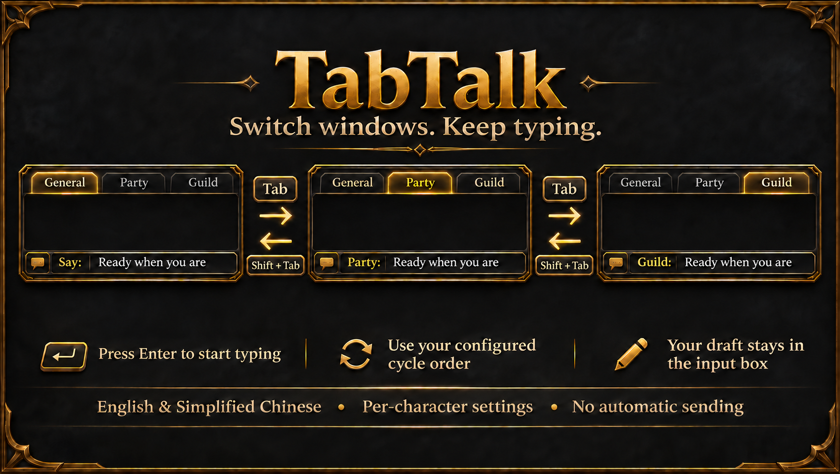
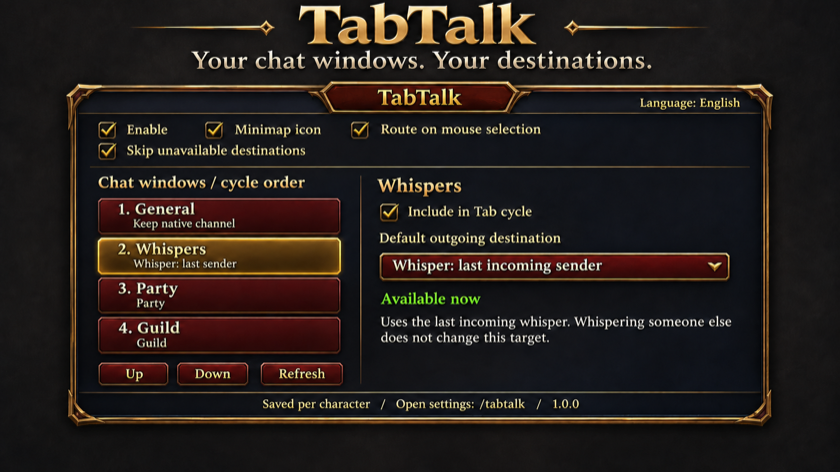

# TabTalk — World of Warcraft: Forever

A lightweight chat-window switching addon for **World of Warcraft: Forever（魔兽世界：无限）1.60.1**, Interface **16001**.

[简体中文](README.md) · [Downloads](https://github.com/iCodyYang/TabTalk/releases) · [Report an issue](https://github.com/iCodyYang/TabTalk/issues)

Press **Enter**, then **Tab** or **Shift+Tab** to cycle through your configured chat windows. Each window can have its own outgoing destination, while your draft and cursor position stay intact.

## Install

Download `TabTalk-1.0.0-Forever.zip` from Releases and extract the **TabTalk** folder into `_forever_/Interface/AddOns/`.
The resulting path must be `_forever_/Interface/AddOns/TabTalk/TabTalk.toc`.
When installing from source, copy this repository's inner `TabTalk/` folder, not the repository root. Restart the game after first installation.

## Configure

1. Create chat windows using the game's native chat settings.
2. Open settings with the minimap button, `/tabtalk`, or `/ttalk`.
3. Select a window, assign its outgoing destination, and arrange the cycle order.
4. Press Enter to type, then Tab to move forward or Shift+Tab to move backward.



*Illustrative preview, not an in-game screenshot.*

New windows keep the native input channel until configured. TabTalk does not create windows or change their message filters.

## Features

- Say, Yell, Emote, Party, Raid, automatic Party/Raid, Instance/Battleground, Raid Warning, Guild and Officer destinations.
- Public/custom channels saved by name rather than channel number.
- Whispers to the last incoming sender, most recent conversation, a specific character, or the current target. Recent-contact rules support character and Battle.net whispers; contacts are not saved across sessions.
- Optional routing when clicking a chat tab, and skipping unavailable destinations.
- English and Simplified Chinese, automatic or manually selected.
- Per-character settings, adjustable font and panel size, draggable circular minimap button.
- No external addon libraries, idle polling, periodic timers, saved chat history, or automatic message sending. Settings controls are created only when opened.



*Designed illustration; actual in-game styling differs.*

## Compatibility and testing

This release targets **Forever 1.60.1 only**. Other WoW branches are not claimed as supported. Combat Log and temporary chat popouts are excluded. Group and guild permissions still apply.

Native slash-command completion and active IME composition retain their handling. Other addons that replace chat windows or take over Tab need separate compatibility testing.

The earlier Chinese build was reported working in game. Version 1.0.0 has automated Lua 5.1 regression coverage; live English-layout, combat/taint and addon coexistence validation remain incomplete. No in-game CPU or memory measurements are claimed.

Run tests with Python and `lupa` installed:

```sh
python3 -m pip install lupa
python3 tests/run.py
```

See [testing notes](docs/TESTING.md) for the manual checklist.

## License

[MIT](LICENSE). Copyright (c) 2026 Cody.
