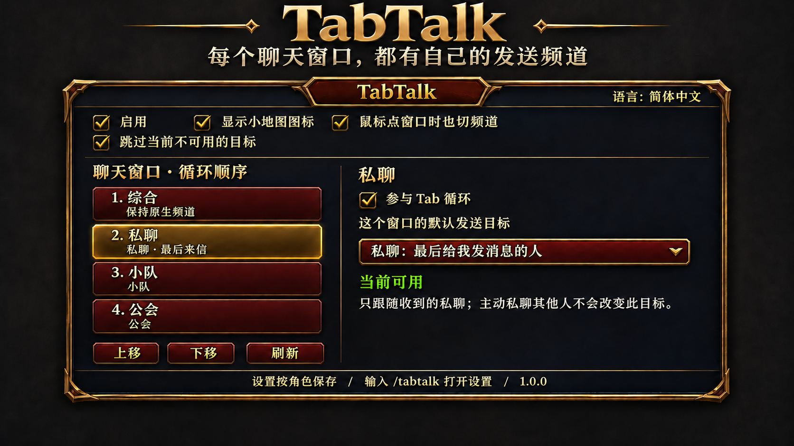
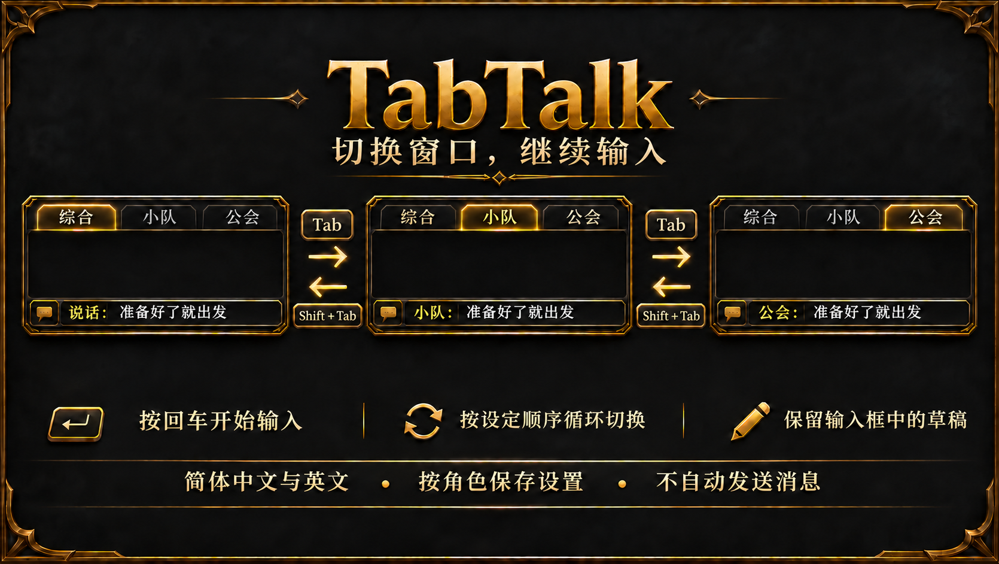

# TabTalk — 魔兽世界：无限

为 **World of Warcraft: Forever 1.60.1（Interface 16001）** 制作的轻量聊天窗口切换插件。内置简体中文与英文。

[English](README.en.md) · [下载安装包](https://github.com/iCodyYang/TabTalk/releases) · [反馈问题](https://github.com/iCodyYang/TabTalk/issues)

## 安装与使用

1. 下载 Release 中的 `TabTalk-1.0.9-Forever.zip`，解压到 `_forever_/Interface/AddOns/`。正确层级为 `TabTalk/TabTalk.toc`。
2. 从源码安装时，复制仓库内层的 `TabTalk/` 文件夹。首次安装后重启游戏。
3. 使用游戏原生设置创建聊天窗口，然后点小地图图标或输入 `/tabtalk`（也支持 `/ttalk`）。
4. 为每个窗口指定发送目标，调整循环顺序。
5. 回车进入输入框后，Tab 切到下一窗口，Shift+Tab 返回上一窗口，保留草稿和光标。

## 1.0.9 更新

- 手柄模式使用原生焦点管理，避免切换后强行拉回旧输入框。
- 战斗记录独立配置；恢复自动跳过开关与独立总开关。
- 新配置默认中文、所有窗口参与循环；语言入口标注 中文 / EN。
- 改进鼠标选择与无可用目标时的输入处理。升级后完全重启游戏，已有设置保留。

## 功能

- 说话、大喊、表情、小队、团队、自动小队/团队、副本/战场、团警、公会和官员频道。
- 公共/自定义频道按名称保存；不会误用重新分配的旧频道编号。
- 私聊可选最后来信者、最近交谈者、固定角色或当前目标。最近联系人规则支持角色和战网私聊，不跨会话保存。
- 可选择鼠标点击窗口时同步发送目标、跳过不可用目标。
- 按角色保存设置；独立字体与面板缩放；可拖动圆形小地图图标。
- 无外部插件库、空闲轮询、周期计时器或聊天历史保存，不自动发送消息。

插件不创建聊天窗口、不改变窗口消息过滤，也不会根据窗口名猜测发送目标。新窗口默认保持原生频道。

## 展示

以上为设计预览，非游戏截图，实际界面样式有所不同。

## 验证与兼容范围

仅声明适配 Forever 1.60.1，不声明支持正式服或其他怀旧服分支。战斗记录可独立配置并参与循环；临时私聊弹出窗口不参与循环，游戏原有发言权限仍然有效。

1.0.9 通过 661 项 Lua 5.1 模拟检查。手柄模式改由原生焦点管理器选择窗口，键鼠分支保留原路径；Steam Deck 的安全拦截与 ABXY 修正仍待实机确认，不能将模拟检查视为安全污染验收。未提供游戏内 CPU/内存实测数据。详见 [测试说明](docs/TESTING.md)。

## 许可证

[MIT License](LICENSE)，Copyright (c) 2026 Cody。
